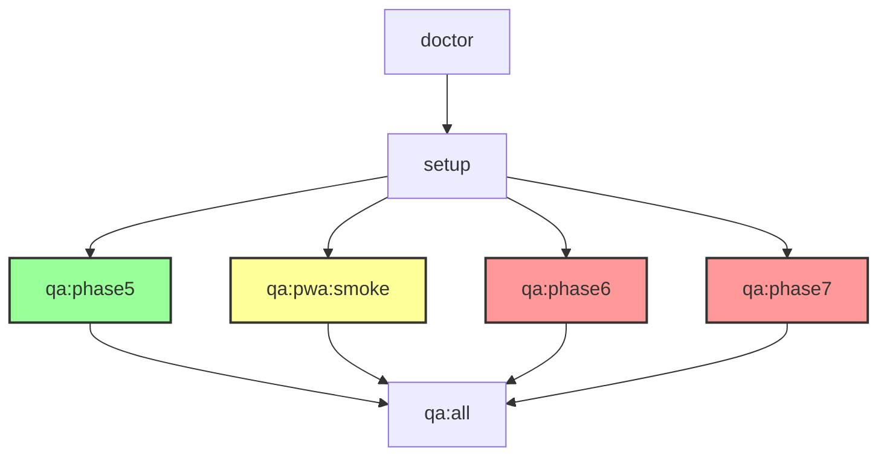

# Análise Detalhada do Taskfile.yml

Esta análise documenta todas as tasks relacionadas a QA no arquivo `Taskfile.yml` do projeto CONSUBOV.

## Visão Geral do Workflow QA

```
doctor → setup → qa:phase5 → qa:pwa:smoke → qa:phase6 → qa:phase7 → qa:all
```

## Tasks Relacionadas a QA

### 1. `doctor`
**Descrição**: Verifica ferramentas disponíveis no sistema

**Comandos**:
```bash
./qa/doctor.sh
```

**Verificações**:
- bash ✅
- git ✅  
- node ✅
- bun ✅
- task ✅
- act/Docker (opcional)

**Diretório**: Raiz do projeto

### 2. `setup`
**Descrição**: Instala dependências do monorepo e navegadores Playwright

**Comandos**:
```bash
bun install --frozen-lockfile
bunx playwright install chromium webkit firefox  # executado em apps/web
```

**Dependências**:
- `bun install` completo
- Playwright browsers (Chromium, WebKit, Firefox)

**Diretório**:
- `bun install`: Raiz
- `playwright install`: `apps/web/`

### 3. `qa:phase5`
**Descrição**: Executa gate da FASE 5

**Comandos**:
```bash
./qa/run-package-script.sh quality:phase5:local
```

**Validação**:
- Verifica se `quality:phase5:local` existe no package.json
- Executa o script com `bun run`

**Status**: ✅ Implementado

### 4. `qa:pwa:smoke`
**Descrição**: Testes PWA superficiais (FASE 6 parcial)

**Comandos**:
```bash
./qa/run-package-script.sh quality:phase6:smoke
```

**Validação**:
- Verifica se `quality:phase6:smoke` existe no package.json
- Executa o script com `bun run`

**Status**: ⚠️ Parcial (NÃO é gate completo da FASE 6)

### 5. `qa:phase6`
**Descrição**: Executa gate da FASE 6

**Comandos**:
```bash
./qa/run-package-script.sh quality:phase6:local
```

**Validação**:
- Verifica se `quality:phase6:local` existe no package.json
- Se não existir, exit code 2: "Script inexistente. Implementar o gate real"

**Status**: ❌ Não implementado

### 6. `qa:phase7`
**Descrição**: Executa gate da FASE 7

**Comandos**:
```bash
./qa/run-package-script.sh quality:phase7:local
```

**Validação**:
- Verifica se `quality:phase7:local` existe no package.json
- Se não existir, exit code 2: "Script inexistente. Implementar o gate real"

**Status**: ❌ Não implementado

### 7. `qa:all`
**Descrição**: Executa todas as fases implementadas

**Dependências**:
- `qa:phase5`
- `qa:phase6`
- `qa:phase7`

**Comportamento**:
- Executa todas as tasks `qa:phaseN` que existem
- Se uma não existir, task continua com as demais

### 8. `qa:act`
**Descrição**: Executa CI local com act (opcional)

**Comandos**:
```bash
./qa/run-act.sh
```

**Pré-requisitos**:
- `act` CLI instalado
- Docker Engine rodando
- `docker info` funcional

**Processo**:
1. Cria `.qa/act-artifacts/` se não existir
2. Executa: `act pull_request --workflows .github/workflows/ci.yml --job build-and-test --artifact-server-path .qa/act-artifacts`

**Status**: ✅ Opcional (requer Docker + act)

## Scripts de Suporte no QA/

### `run-package-script.sh`
**Propósito**: Valida e executa scripts do package.json

**Parâmetros**: `<script-name>`

**Funcionamento**:
1. Verifica se script existe no package.json
2. Se não existir: `exit 2` + mensagem de erro
3. Se existir: `bun run <script-name>`

### `doctor.sh`
**Propósito**: Verifica dependências do sistema

**Verificações**:
- bash, git, node, bun, task (obrigatórios)
- act/Docker (opcional)

### `record.sh`
**Propósito**: Grava execuções com logs e metadados

**Uso**: `record.sh NOME COMANDO [ARG...]`

**Cria**:
```
.qa/runs/<data>-<nome>-<commit>/
├── output.log
└── result.json (com timestamps, status, exit code)
```

### `run-act.sh`
**Propósito**: Executa act para CI local

**Pré-verificação**: act + Docker disponíveis

## Árvore de Dependências



## Status dos Scripts no package.json

### Implementados ✅
- `quality:phase5:local` - Gate completo FASE 5

### Parcial ⚠️
- `quality:phase6:smoke` - Smoke tests PWA (FASE 6 parcial)

### Pendentes ❌
- `quality:phase6:local` - Gate completo FASE 6
- `quality:phase7:local` - Gate completo FASE 7

## Critérios de Execução Bem-Sucedida

### Para cada task `qa:phaseN`:
1. Script correspondente existe em `package.json`
2. `bun run <script>` retorna exit code 0
3. Execução registrada em `.qa/runs/`

### Para `task setup`:
1. `bun install` completa sem erros
2. Navegadores Playwright instalados (Chromium, WebKit, Firefox)

### Para `task doctor`:
1. Todas as ferramentas obrigatórias disponíveis
2. Versões de Bun e Go Task mostradas

## Problemas Conhecidos

### Bloqueio pelo Classificador
Atualmente, todas as operações de escrita estão bloqueadas devido a:
```
openrouter is temporarily unavailable (server error)
```

**Workaround**: Executar comandos manualmente via terminal

### Windows/WSL
- Scripts bash podem precisar de ajustes
- Verificar paths corretos para binários
- Confirmar permissões de execução

## Próximos Passos de Implementação

### Alta Prioridade
1. **Implementar `quality:phase6:local`**
   - Testes completos de upgrade PWA antigo→novo
   - Mesmo origin, IndexedDB, filas, fotos offline

2. **Implementar `quality:phase7:local`**
   - Gate completo da FASE 7
   - Critérios específicos da fase

### Baixa Prioridade
3. **Melhorar `qa:act`**
   - Script mais robusto para falhas de Docker
   - Cache de imagens para execuções subsequentes

4. **Documentação adicional**
   - Guia para troubleshooting específico
   - Exemplos de execução para novos desenvolvedores

## Referências

- **Taskfile Original**: `CONSUBOV_GO_TASK_QA_LOCAL/Taskfile.yml`
- **Documentação Kit**: `.work-go-task/consubov-go-task-kit/README.md`
- **Config VS Code**: `.vscode/extensions.json` e `.vscode/tasks.json`

---

**Última Análise**: Baseado em Taskfile.yml do commit `8fcba596`
**Problemas Atuais**: Classificador bloqueando operações de escrita
**Recomendação**: Executar scripts manualmente via `qa/setup-qa-environment.ps1`
